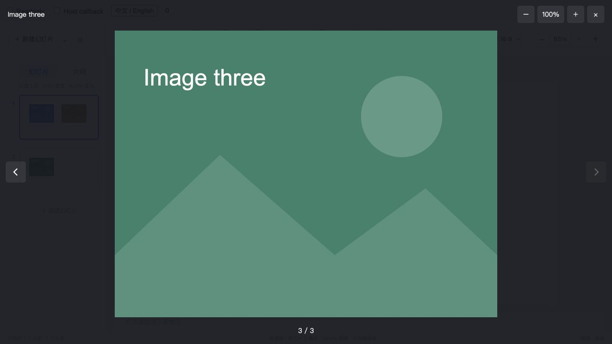

# Slides image preview verification

2026-10-21 · `@smartdoca/slides` `0.3.0-alpha.4`

## Public API

Both `PresentationWorkspaceProps` and `PresentationEditorProps` expose `onImagePreview?: PresentationImagePreviewHandler` in the generated package declarations. The root and `core` export `PresentationImagePreviewItem`, `PresentationImagePreviewEvent`, `PresentationImagePreviewHandler`, `presentationImages` and `presentationImagePreview`. See the [resource and gallery contract](../../IMAGE-PREVIEW.md).

The callback receives `currentId` and `gallery`, with each occurrence carrying opaque `id`, `slideId`, `elementId`, stable `assetId` and optional `alt`. Images from every ordered slide participate. No resolved URL or other document is added. A host callback replaces the package lightbox; resource ACL, downloads and protected document modes remain host-owned.

## Passed checks

- TypeScript and the production ESM/CommonJS/declaration build.
- Full suite: 203 cases passed, including the real 60-second idle check; 3 opt-in cases were skipped in that run. Two isolated service integrations were run separately and passed; the performance case was not run.
- Native image selection before tap dispatch, second-click/fast-double-click preview without duplicate callbacks, explicit preview button, latest host callback, readonly preview, callback errors, image identity, cross-slide gallery order, duplicate asset occurrences and live remote deletion without an echo or undo entry.
- Standalone previous/next, arrow keys, horizontal wheel, horizontal drag at fit, zoom/pan, focus trapping/restoration, retry after authorization failure and locale changes.
- Actual tgz installed in an isolated React consumer: root public types, ESM/CommonJS core/collaboration/PPTX subpaths, pure gallery queries without writes and native PPTX roundtrip.
- Source and installed-package browsers: edit mode first selects, the next click opens, readonly single-click opens, default navigation crosses into the next slide, and the host callback receives three stable image occurrences while the default dialog stays closed. Console error lists were empty.
- Native object dragging still makes one editing transaction and does not open the viewer. Preview actions before that intentional edit retained zero transactions.
- Source-browser observation: 113.768 seconds, transaction counter `0 → 0` (`1792589883637 → 1792589997405`). All fixtures and server databases are isolated synthetic test data.

## Persisted-format audit

The published alpha.3 tarball was read without installing scripts. These current generated files are byte-identical:

| File | SHA-256 |
| --- | --- |
| `dist/collaboration/index.cjs` | `dc9d8b9c9ac6efd8ceb67233d4cfeefbbe024578d710921cfbb4290f02c4e554` |
| `dist/pptx.cjs` | `8a0ae756faacded12eca23dba88e99d8785b71041806ba21c7c77d23d6d67717` |
| `dist/types-DlyJuOK0.d.ts` | `b1d535697f81cb89cd6a73cd5f666ee866060b9ade0ea6bad1c1f02368299207` |

No existing model/controller/validation, collaboration transport/codec or PPTX source is changed. The new model module is a read-only image-reference query. Protocol 1, schema 2 and codec revision 6 retain their existing rules; no compatibility reader, migration, default-field backfill, document conversion, epoch/checkpoint replacement or alternate save path is introduced.

This package-only record does not establish the Doca unified host viewer, production ACL integration, native-device gesture coverage or real Office/WPS visual acceptance. The Doca checkout is not modified by this package work; the integrating host owns its dependency pin, adapter, shared contract inventories and website acceptance.

